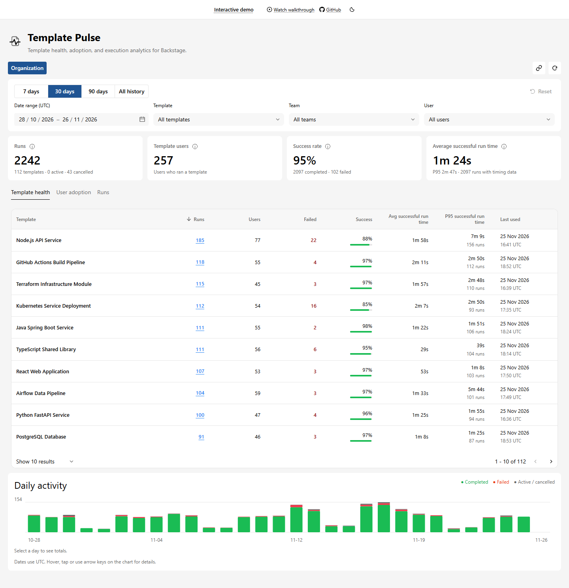
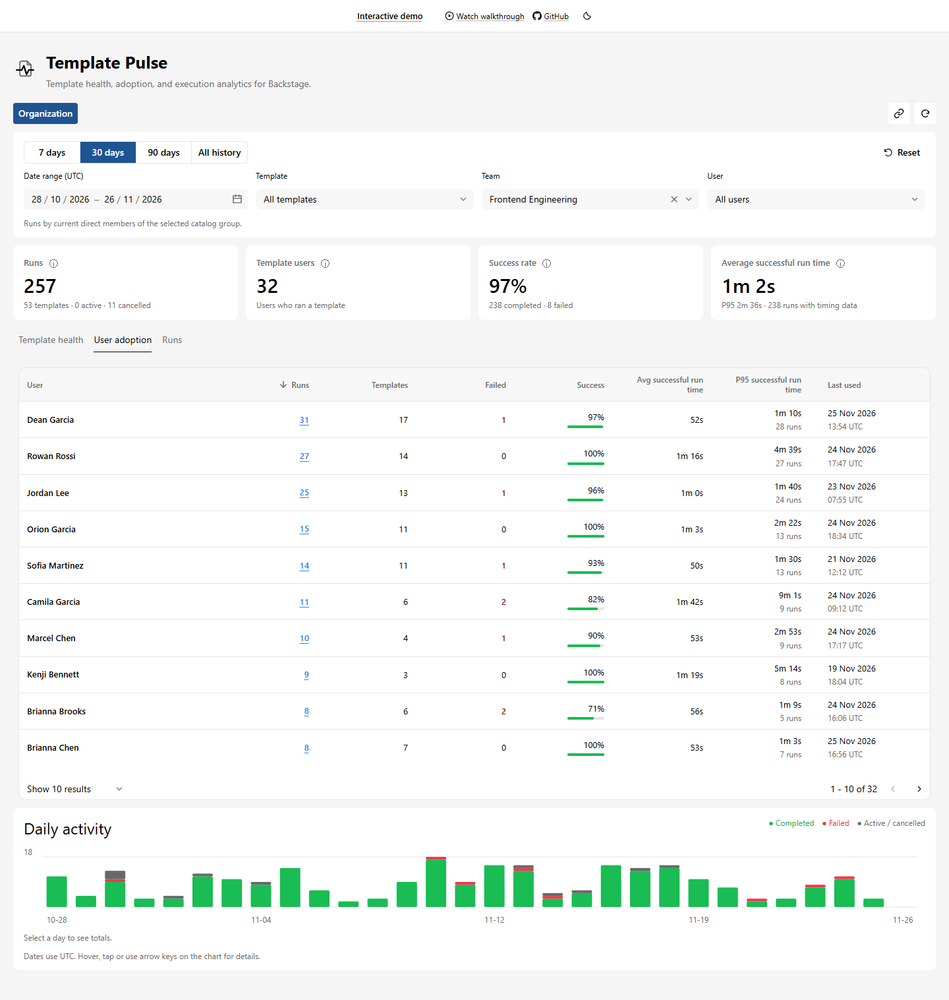
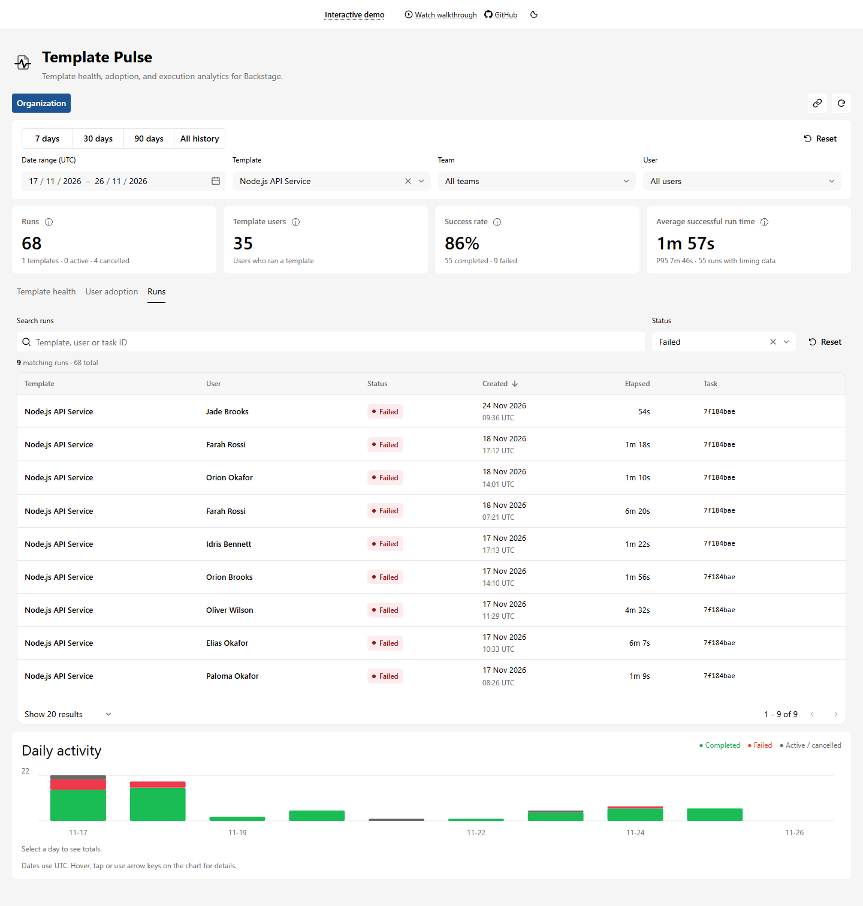
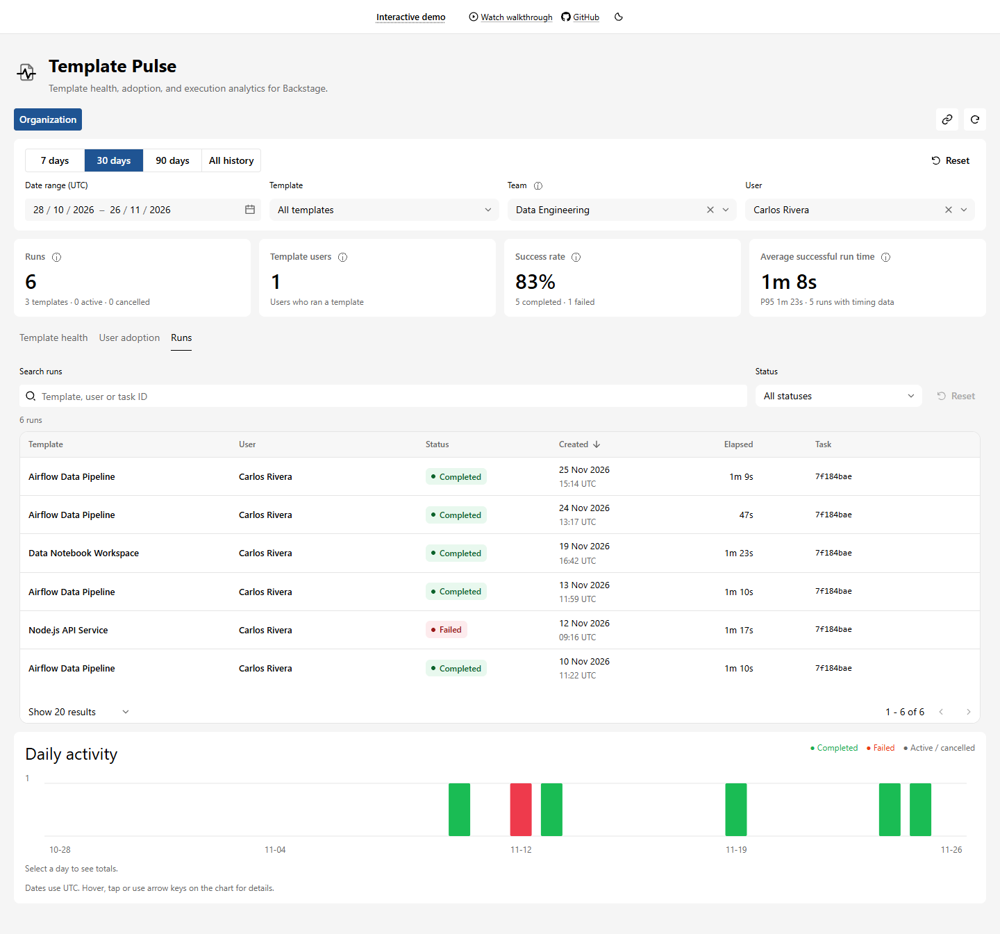

# Template Pulse Demo

**[Try the live demo](https://alibayramli.github.io/template-pulse-demo/)** · [Install the plugin](https://github.com/alibayramli/template-pulse#add-to-backstage)

Try Template Pulse with sample data or a local Backstage backend.

## Preview

Try the dashboard with sample data. No backend or sign-in needed.



<details>
<summary>Teams and run history</summary>







</details>

## Run the showcase

Use Node.js 22 or 24 and enable Corepack:

```sh
corepack enable
yarn install
yarn start:demo
```

Open [localhost:3000](http://localhost:3000) for 50 templates, 100 users, and 350 sample runs. Everything runs in your browser; templates are not executed. Use the backend below to test real run history and search.

## Run with a backend

```sh
yarn start
```

Open [Template Pulse](http://localhost:3000/template-pulse) and choose **Enter** to sign in as **Admin User** (`user:default/admin`). Run `yarn seed:analytics` in another terminal to add sample history, or run a Scaffolder template.

To try a regular user, stop the app and run `yarn start:user`, then sign out and back in. History is saved locally in `.data/`.

The registered history module enables **All history** automatically. Older pages expire after two minutes. Reload when asked. [History limits and setup for multiple backend servers](https://github.com/alibayramli/template-pulse/tree/main/plugins/scaffolder-backend-module-template-pulse#readme)

Guest sign-in and demo permissions are for local testing. Use your own sign-in and permissions when hosting Backstage.

## Build and develop

- `yarn build:demo` builds the static showcase in `packages/app/dist/`. Set `DEMO_BASE_URL` to build for another public URL.
- `yarn test:demo` runs the demo tests. Before deploying, run `yarn tsc`, `yarn lint`, `yarn test`, `yarn build`, and `yarn build:demo`.

Update all Template Pulse packages together:

```sh
yarn up '@abayramli/backstage-plugin-*'
```

Pushing to `main` publishes the browser demo. Set **Settings > Pages > Source** to **GitHub Actions**. History in `.data/` stays local.
