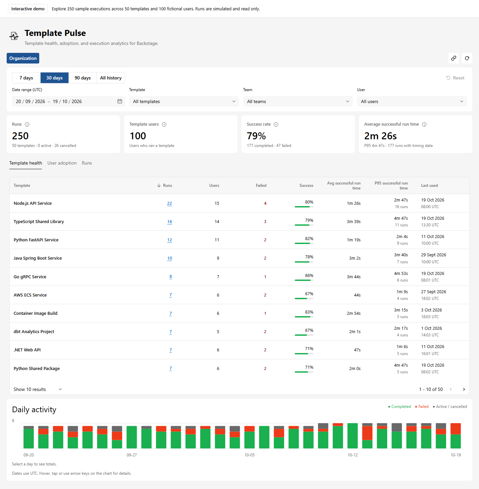
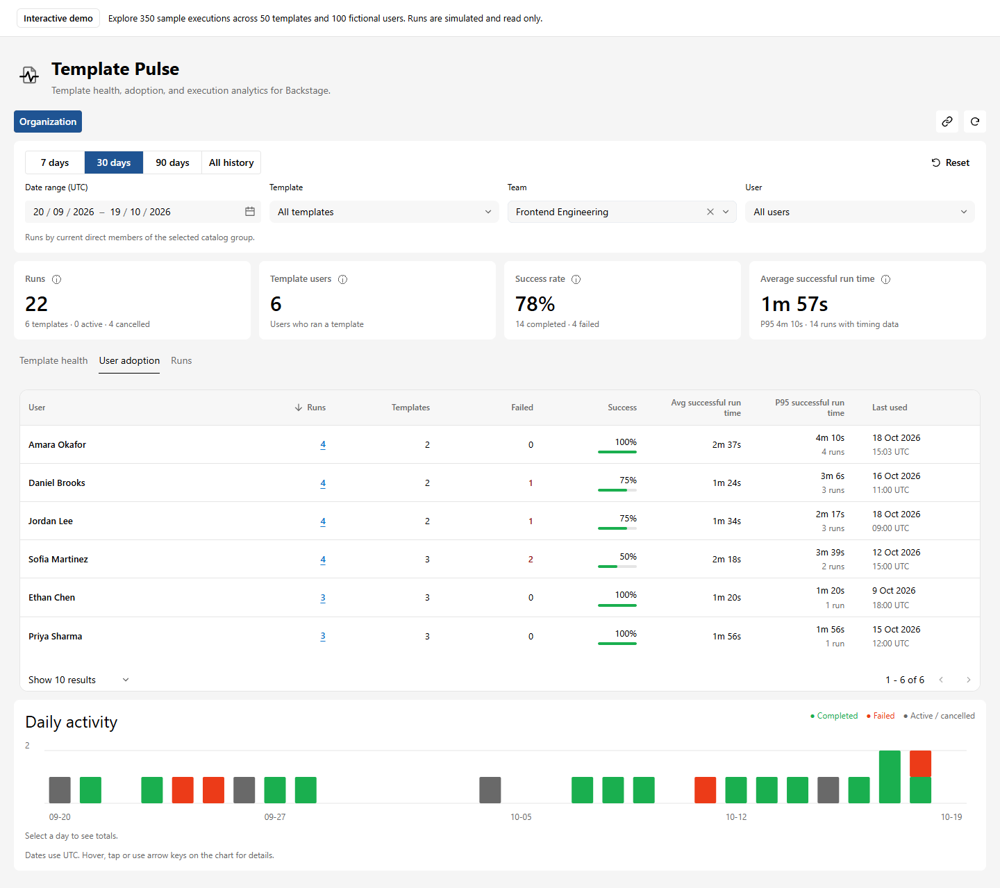
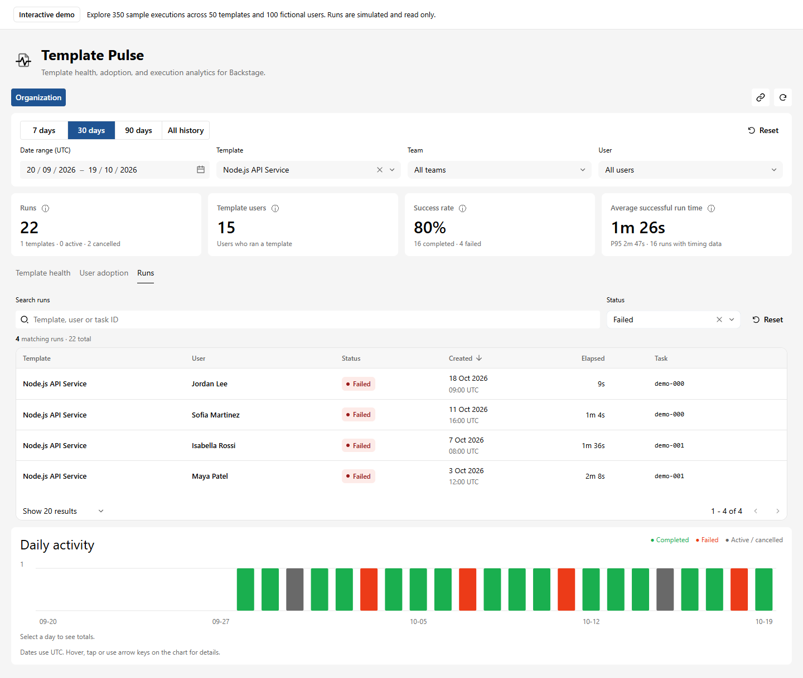
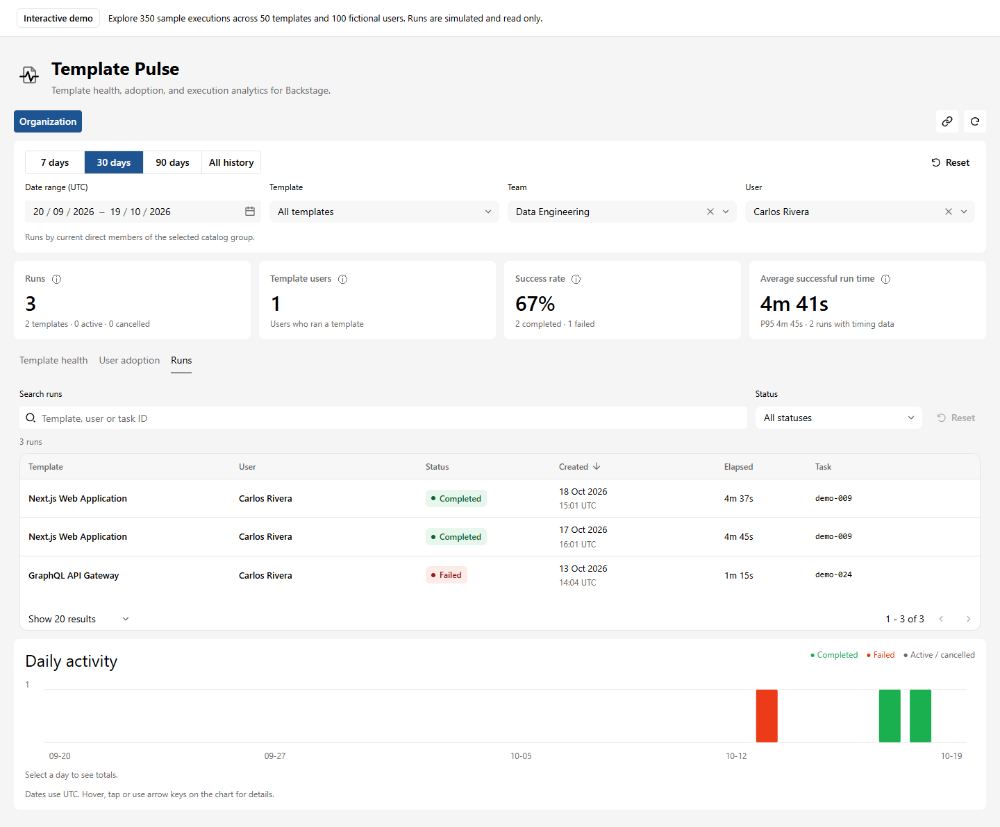

# Template Pulse Demo

**[Try the live demo](https://alibayramli.github.io/template-pulse-demo/)** · [Install the plugin](https://github.com/alibayramli/template-pulse#add-to-backstage)

A Backstage app for exploring Template Pulse: template usage, success rates, run times, and searchable execution history.

## Preview

Interactive showcase with fictional data; no backend or sign-in required.



<details>
<summary>Team adoption and filtered runs</summary>







</details>

## Run the showcase

Requires Node.js 22 or 24 and Yarn 4.

```sh
yarn install
yarn start:demo
```

Open [localhost:3000](http://localhost:3000). The showcase uses fictional data for 50 templates, 100 users, and 350 runs. It runs entirely in the browser, with no sign-in, backend, or template execution.

## Run with a backend

```sh
yarn start
```

Open [Template Pulse](http://localhost:3000/template-pulse) and choose **Enter** to sign in as **Admin User** (`user:default/admin`). Use **My analytics** to see this user's executions. Run `yarn seed:analytics` in another terminal after startup to add sample history, or run a template through Scaffolder.

Use `yarn start:user` for a regular user. Stop the app before switching, then sign out and back in. Local history is saved in the ignored `.data/` directory.

The backend uses guest identities and a demo permission policy for local use. Use your own authentication and permission policy for a deployed Backstage app.

## Build and develop

- `yarn build:demo` builds the static showcase in `packages/app/dist/`. Set `DEMO_BASE_URL` to build for another public URL.
- `yarn test:demo` checks the showcase; `yarn build`, `yarn tsc`, `yarn lint`, and `yarn test` check the full app.
- After changes in a sibling `template-pulse` checkout, run `yarn sync:plugins --from-plugin`, then `yarn install` to refresh workspace dependencies and `yarn sync:plugins --check` to verify all five packages match. Sync includes source, tests, package metadata, licenses, assets, and file removals.
- When plugin package names or APIs change, update the imports and dependencies in `packages/app` and `packages/backend` too. Run `yarn tsc`, `yarn lint`, `yarn test`, `yarn build`, and `yarn build:demo` before deploying. `yarn sync:plugins` also supports conflict-safe bidirectional syncing for local development.

The GitHub Actions workflow deploys the showcase on pushes to `main`. Set **Settings → Pages → Source** to **GitHub Actions**. Only the static build is published; local history stays in `.data/`.
